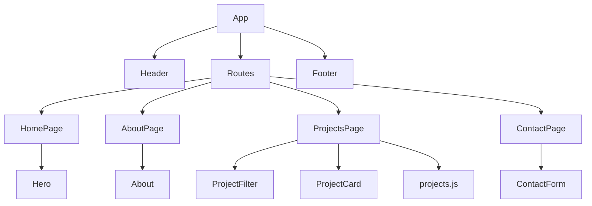

# React Portfolio

En responsiv portfolio byggd med React. Portfolion presenterar mig, mina kunskaper och ett urval av projekt. Besökaren kan navigera mellan flera sidor, filtrera projekt efter teknik och använda ett validerat kontaktformulär.

## Funktioner

- Responsiv navigation med hamburgarmeny
- Separata sidor med React Router
- Projektlista som genereras från projektdata
- Multifilter där flera tekniker kan väljas samtidigt
- Kontrollerat kontaktformulär med validering
- Anpassad layout för mobil och desktop
- Tillgängliga formulärfält och navigationslänkar

## Tekniker och verktyg

- React
- JavaScript
- React Router
- React Icons
- CSS Modules
- Vite
- Git och GitHub
- Figma
- Vercel

## Kör projektet lokalt

### Förutsättningar

Du behöver ha [Node.js](https://nodejs.org/) installerat.

### Installation

1. Klona repot:

   ```bash
   git clone https://github.com/kickzon/react-portfolio.git
   ```

2. Gå till projektmappen:

   ```bash
   cd react-portfolio
   ```

3. Installera projektets beroenden:

   ```bash
   npm install
   ```

4. Starta utvecklingsservern:

   ```bash
   npm run dev
   ```

5. Öppna adressen som visas i terminalen, vanligtvis `http://localhost:5173`.

## Länkar

- [GitHub-repo](https://github.com/kickzon/react-portfolio)
- [Live-version](https://react-portfolio-drab-mu.vercel.app/)
- [Figma-skiss](https://www.figma.com/design/qS0Vmoh9ob1Q5FCI0ySMNA/Chiara-Portfolio?node-id=0-1&t=iUkuFUtx3UQcian6-1)

## Komponentarkitektur

Applikationen är uppdelad i mindre komponenter med tydliga ansvarsområden. Sidorna sätts samman av komponenterna och projektinformationen ligger i en separat datafil. Det gör det enklare att återanvända komponenter och lägga till nya projekt utan att ändra strukturen i gränssnittet.



## State-hantering

State ligger nära de komponenter som använder informationen:

- `Header` hanterar om mobilmenyn är öppen eller stängd.
- `ProjectsPage` hanterar valda tekniker och räknar fram den filtrerade projektlistan vid rendering.
- `ContactForm` hanterar formulärvärdena i ett gemensamt objekt samt valideringsfel och formulärets bekräftelsemeddelande.

Projektfiltret använder en array eftersom flera tekniker kan vara valda samtidigt. Ett projekt visas endast om det innehåller alla valda tekniker. Formulärets fält ligger i ett gemensamt objekt eftersom de hör ihop och kan uppdateras med samma ändringsfunktion.


## Reflektion

Under arbetet med min portfolio har jag framför allt lärt mig mer om hur en React-applikation kan delas upp i komponenter och hur state används för att göra sidan interaktiv. I början var det svårt att veta vilka delar som skulle vara egna komponenter. Genom att dela upp sidan i exempelvis Header, Hero, ProjectCard, ProjectFilter och ContactForm blev strukturen tydligare. Jag märkte också att komponenter blir enklare att förstå när de har ett tydligt ansvarsområde.

Ett viktigt beslut var att lagra projektinformationen i en separat datafil. Det gör att samma ProjectCard-komponent kan användas för alla projekt och att nya projekt kan läggas till utan att kortets kod behöver kopieras. I projektfiltret sparas de valda teknikerna i en array. Den filtrerade listan sparas inte i eget state, utan räknas fram från projektlistan och de valda teknikerna vid varje rendering. På så sätt undviker jag att lagra information som redan kan beräknas.

Kontaktformuläret var en av de mer utmanande delarna. Alla formulärfält lagras i ett gemensamt objekt och uppdateras med samma funktion. Jag har också lagt till validering, felmeddelanden och ett bekräftelsemeddelande. Genom detta fick jag en bättre förståelse för kontrollerade formulär och hur React uppdaterar gränssnittet när state förändras.

Om jag gjorde om projektet skulle jag börja med en mer detaljerad Figma-skiss och planera komponentstrukturen tidigare. Det hade gjort det lättare att hålla en enhetlig design från början. Jag skulle även vilja lägga till fler riktiga projekt, förbättra formuläret så att det faktiskt skickar meddelanden och arbeta vidare med animationer. Projektet har gett mig större förståelse för React, responsiv design, tillgänglighet och hur en webbapplikation kan byggas upp steg för steg.

## AI-användning

OpenAI Codex har använts som stöd under projektet för handledning, felsökning och förklaringar av React, state och komponentstruktur. OpenAI:s bildgenereringsverktyg har använts för att skapa tillfälliga illustrationer till de fiktiva projekten.

Förslagen har granskats, testats och anpassats innan de lagts in i projektet. AI har fungerat som ett stöd i lärandet och besluten, medan implementationen har skrivits och testats stegvis av mig.
